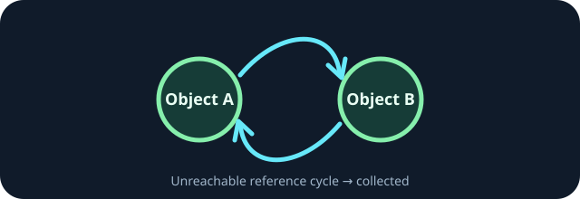

<div align="center">


<p><strong>A dependency-free CLI for a controlled Python garbage-collection experiment.</strong></p>
   
<br/>
</div>

## 🧭 Overview
Python GC Lab creates a bounded set of self-referencing Python objects, releases the references, and asks the cyclic garbage collector to reclaim them. It reports collector thresholds, counts, and reclaimed cycles.

## ✨ Features
- ♻️ Create controlled self-reference cycles.
- 📊 Report tracked objects and collected object counts.
- 🧮 Show GC generation counts and thresholds.
- 🧾 Emit readable text or JSON output.
- 🛡️ Avoid inspecting or modifying other processes.

## 🎬 Demo
Run the command to create 100 cycles and observe how many become unreachable and are reclaimed. Use the JSON option for scripting.

## 🚀 Quick Start
Requires Python 3.10 or newer. No third-party packages are needed.

```bash
python main.py
```

Use `python main.py --cycles 500 --json` for structured output, or `python main.py --no-demo` to inspect settings only. Run checks with `python -m unittest discover -s tests -v`.

## 🧰 Tech Stack
- 🐍 Python standard library: gc, weakref, argparse, json
- 🧪 unittest

## 🗂️ Folder Structure
```text
main.py                 CLI and controlled GC experiment
tests/test_gc_lab.py    Automated tests
assets/mark.svg         Original project illustration
requirements.txt        No external dependencies
.github/workflows/      Python CI
```

## 🛣️ Roadmap
- [ ] Add a generation-by-generation collection mode.
- [ ] Compare cyclic and reference-counted object lifetimes.
- [ ] Export a compact before/after report.

## 🤝 Contributing
Contributions are welcome. Keep experiments bounded and deterministic, and never make the tool modify global garbage-collector settings without an explicit option and tests.

## 📄 License
MIT. See LICENSE.

<div align="center"></div>
